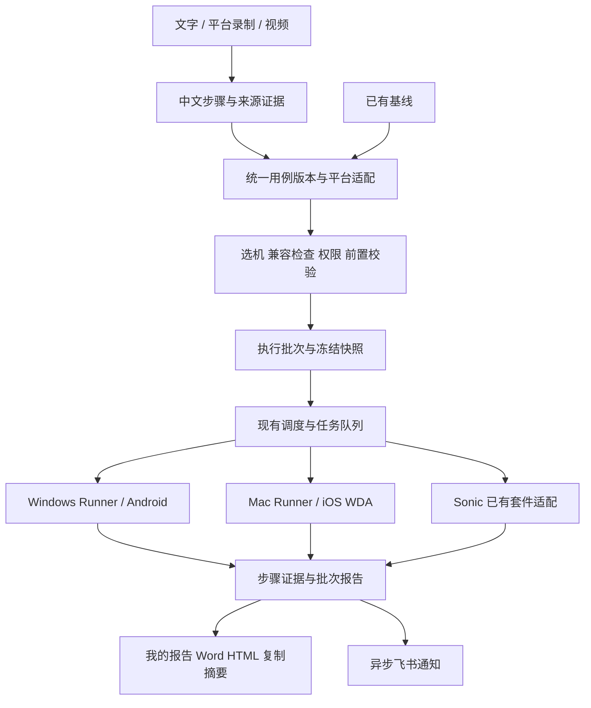

# 跨平台 UI 测试与 AI 用例入口设计

日期：2026-10-13。状态：修改方案，尚未实施。配套任务见 [实施计划](../plans/2026-10-13-simple-cross-platform-ui.md)。

## 1. 目标与范围

普通使用者不需要了解 YAML、ADB、WDA、Runner 或 Sonic 的部署关系，就能选择手机执行基线，获得属于自己这次执行的报告；通过自然语言、平台录制或操作视频创建可验证的用例。管理员配置应用、设备和通知渠道，维护者管理共享基线，执行者使用已发布基线。

本次设计覆盖 UI 测试全链路的收敛，不重写 API 自动化、压测、已有定时任务或账号系统。现有高级入口保留，默认收起；新入口逐步成为默认页面。复用现有身份权限、AI Gateway、用例/YAML 校验、Runner、Sonic、DOCX 导出和飞书发送能力。

用户此次要求是制定修改计划。本次不改运行逻辑、不触发设备测试、不部署、不发送飞书消息。

## 2. 已核对现状及缺口

以下为仓库 `bb7bc93` 的代码与 CODEX_STATE 证据；线上状态在实施时重新核验。

| 领域 | 已有能力 | 需要补齐 |
| --- | --- | --- |
| 跨端执行 | Windows Android、Mac iOS Runner；手机信息与截图；iOS WDA 有界恢复 | Mac 的 `prepare_ios_yaml` 仅放行 launch、aiTap、aiWaitFor、aiAssert；含输入、滑动、安卓按键的脚本不能宣称可直接复用 |
| 设备匹配 | 明确 device_id、target_runner_id，现有任务领取与占用状态 | `get_available_runner` 仍有按 workspace/label 猜平台、最后选任意 Runner 的辅助逻辑；需核对调用方并封住新 UI 入口的隐式改机路径 |
| 应用配置 | 应用、业务线、模块、Sonic 套件、应用飞书渠道 | Android package 与 iOS bundle 映射仍部分依赖 Mac 本地环境；缺平台统一业务应用标识和兼容提示 |
| AI 生成 | 需求理解、用例规划、Top3 基线、YAML 生成、评分和冒烟门禁 | 多入口偏工程化；文字、录制与未来视频缺统一的可编辑步骤与证据契约 |
| 录制 | 截图、点击语义、红点校正、步骤删除、检查点、生成 YAML | 当前生成器固定输出 android，BACK/HOME/ENTER 转 ADB；需要平台能力适配，不能直接承诺 iOS 实录已完成 |
| 视频 | Prompt 入参提及 videos_or_analysis | 未在本轮检查的服务/前端/Gateway 中发现完整的视频上传、抽帧、步骤对齐、异步取消链路；需作为新流水线建设 |
| 身份 | 稳定用户 ID、角色、应用权限和操作审计 | 运行者、基线作者、Runner 执行主体、报告所有者要分开；不能依赖手填 tester 或审计反查来做实时权限判断 |
| 报告 | 执行报告、脑图报告、真实 DOCX/HTML/Markdown | `test_report_service._indexed_execution_map` 存在按模块/同名 YAML 找最近报告的路径，缺运行批次约束；该路径不适用于“我的这次执行报告” |
| 飞书 | 应用 webhook、卡片、Sonic 套件通知去重；API 子系统另有通知记录 | 复用发送与展示组件，统一 UI 批次触发和重试；避免 Sonic 回调和新批次各发一份 |
| 稳定性 | iPhone 13 已有多轮真实回放和 WDA 恢复记录 | 首次“我的”点击未跳转的原因尚未证实；下拉刷新失焦、执行中错误归因短暂展示 false 尚待收尾 |

依据文件：`mac-midscene-runner.py`、`task_server/services/{runner_service,job_service,agent_service,device_recording_yaml_service,test_report_service,feishu_service,sonic_service,operation_attribution}.py`、`task_server/{identity,access_control}.py`。

## 3. 方案取舍

1. **推荐：在现有平台内增加统一业务流程和薄适配层。** 共用用例、运行批次、报告和 AI 步骤模型；Android/iOS 差异放在适配层。可以逐批上线，现有 Runner/Sonic 和资产继续使用。
2. 只增加 iOS 下拉框、视频上传和若干按钮：改动快，但执行归属、兼容性、报告关联仍然分散，后续继续补洞。
3. 全面重写前后端、调度和资产库：迁移范围大，无法先解决用户当前执行问题。本轮不采用。

“一份业务用例”不等于两个平台的动作完全一样。公共步骤共用，少量平台差异作为同一用例版本下的覆盖项；不维护两套业务内容，也不以机械换包名声称所有用例跨端兼容。

## 4. 普通使用者的三个入口

### 4.1 开始测试

页面默认显示“跑基线”和“AI 生成用例”两个入口，显示最近使用的应用和本人最近执行；首次使用不要求配置模型、Runner 或报告模板。

**跑基线：** 选应用 → 选基线/套件 → 选手机 → 开始测试。

- 应用、套件使用本人最近选择作为预填，开始前清楚展示范围。已进入某基线详情时只需选手机和开始。
- 手机卡片展示平台、机型、应用版本、实时就绪状态、占用人和截图时间；不把旧截图当实时画面。
- 一个兼容设备可预选，但开始前显示设备名称；多设备不自动猜。用户明确选择的手机离线、被占用或不兼容时，提示等待/改选，绝不静默换机。
- 兼容检查直接显示“可执行”“需适配：第 4 步使用 Android 返回键”“未就绪：请解锁手机”等具体原因。
- 默认一次选一台，第一批闭环后支持展开“同时比较 Android/iOS”；每台产生独立子结果，不能把一台通过算成两台通过。
- 测试数据与必要前置由套件预设；发现缺失时集中展示待填项，普通执行不重复填写管理员配置。
- 开始后当前运行置顶，显示准备阶段、排队、用例/步骤、耗时。步骤灰色未执行、蓝色执行中、绿色通过、红色失败；取消、阻塞、跳过使用文字/图标区分，不能只靠颜色。
- “停止”“仅重跑失败项”“查看报告”就近提供；失败记录保留。重跑生成新尝试，保留首次结果和父批次关系。

### 4.2 AI 生成用例

使用一个输入区，支持文字输入、选择平台录制、上传录屏、补充截图/需求材料。三种主要输入都转换为同一份中文步骤，不让用户先选复杂工作流。

示例输入：“智小白 3D，打开我的，进入打印记录，返回后切到首页，检查首页的新手必学入口。”

AI 产出：应用/模块建议、前置条件、操作步骤、页面等待、预期结果、来源证据和需要补充的地方。页面以紧凑步骤列表展示，支持修改、排序、删除、增加检查点和恢复上一版；YAML 放在“高级”折叠中。

- 明确命令直接转步骤；缺少预期时给出建议并标为待确认。一次集中询问关键歧义，不让用户逐步写代码。
- 建议由 AI 产生，检查是否有执行证据由平台决定。隐藏菜单、登录状态、测试数据不确定时不能编造。
- “生成并试跑”按钮把静态校验、评分、可用的 dry-run 和受控实机试跑串联，遇到缺信息才暂停。用户只生成草稿时不自动操作手机。
- 成功后保存为本人用例；有权限的维护者可发布/更新共享基线。已有基线执行失败时只生成修复草稿，不自动覆盖、弱化断言或重复执行有副作用步骤。
- AI 补充边界/异常场景作为推荐列表，默认不扩大发送范围。自动化生成按现行 3/5/最多 8 条限制，首批最多 3 条、冒烟通过率至少 50% 才继续；正式既有基线的选定执行范围沿用其策略。

**平台录制：** 优先利用真实动作、动作前后截图与既有语义识别。iOS 采集必须先验证控制事件与截图能力；未通过前清楚标“暂不支持实时录制，可上传录屏”，不展示一个可点但失效的开始按钮。

**上传视频：** 校验与抽帧 → 合并重复/等待片段 → 识别页面变化和动作 → 对齐中文步骤、时间戳和截图 → 补齐预期 → 选手机试跑。

- 每步可点开对应视频片段。没有可见触点时，目标来自页面变化推断，必须明确标记依据；转场模糊、分支不明、缺少结果的步骤进入待确认。
- 不把每帧变成步骤，不照抄视频的等待时长，不将截屏坐标作为默认执行定位。生成语义定位和条件等待，关键转场后增加有证据的断言。
- 无法从视频推断密码、不可见数据、隐式前置或外部系统结果。视频是用例来源，试跑报告才是执行证据。
- MVP 默认受理 MP4/MOV，解码前检查真实格式；每文件不超过 200 MB/10 分钟。后台抽帧单任务执行，首轮模型候选帧最多 60 张，超出选择明确片段或分段，不悄悄漏掉后半段。数值作为初始产品配置，发布前用真实素材调校。
- 展示阶段及已处理时长/总时长，AI 阶段显示耗时和超时操作，不伪造完成百分比。取消后停止后续模型调用，保留可恢复草稿，临时抽帧按保留策略清理。

### 4.3 用例库与我的报告

- 导航收敛为“开始测试 / 用例库 / 我的报告”；设备、应用、通知和权限配置进入管理区。原高级工具作为二级入口保留。
- 用例库按应用 → 模块 → 套件组织，支持名称/步骤关键词搜索。全部应用每组先展示最近 3 条，展开后分页；保留用户此前的有限预览要求。
- 用例显示 Android/iOS 的各自验证状态、最近实际执行、版本和维护者；“兼容”与“已在该平台通过”分开。
- 报告默认“我执行的”，可筛选应用、套件、设备、时间和状态；有权限时切换团队报告。共享基线由 A 创建、B 执行，报告发起人必须是 B。
- 自动生成每次批次报告，不再要求重复输入测试人员、应用版本、设备或起止时间。手工备注和人工结果保留为显式补充，不能冒充 Runner 结果。
- 下载 Word、查看 HTML、复制简洁结果摘要。文件名示例：`智小白3D-导航基线-张三-20261013-批次短号-测试报告.docx`，后缀只加一次，文件内记录完整批次 ID。

## 5. 内部结构与数据边界

### 5.1 应用和设备

- `app_id`：业务应用稳定 ID；现有 Android package 暂作别名，避免破坏现有应用权限和文件目录。平台映射记录 `android.package`、`ios.bundle_id`，版本由手机实时读取。
- `DeviceTarget`：`runner_id + device_id + platform` 唯一指向手机；兼容性取 Runner 声明和实测能力，不取名字或 workspace 猜测。
- 能力包括动作/参数支持、CLI 版本、步骤回传、截图、录制、应用安装、dry-run；每项可独立不可用。连接在线不等于能执行 UI。
- 打印机 MAC/序列号属于 `fixture` 业务测试数据，绝不混入手机 device_id。`9888E0094F2A` 是历史业务打印机标识；真机测试必须选择明确手机 UDID/ADB serial。
- 普通基线执行不隐式更新应用、不重签 WDA、不重启正在工作中的 Runner。环境修复有界且只管理自己的进程；业务任务中断后记录阻塞，恢复环境不等于自动重放业务。

### 5.2 一份用例与编译

`CaseVersion`：稳定 case_id、不可变 revision、app_id/module、来源、步骤、前置、断言、测试数据契约、平台适配、验证记录。

`CaseStep`：step_id、intent、target、value_ref、wait_condition、expected、source_ref、platform_overrides、review_state。实际 YAML 仍只使用当前 Runner 支持的官方 action/参数；该结构是平台内部模型，不直接交给 CLI。

- 旧 YAML 首次加入新流程时只读导入：可解析动作映射步骤，未知动作保留为高级原文并标兼容阻塞，不丢内容、不批量改历史文件。
- 新生成步骤是源；从高级 YAML 修改时重新解析为新候选版本，校验失败不覆盖已发布版本。不能让两个可编辑源静默互相覆盖。
- 平台返回导航优先明确的页面返回目标；真正 Android 系统返回保留为 Android 专项动作。iOS 无等效动作时要求适配，不能把系统返回机械变成某固定点击。
- 调度前冻结用例版本、源内容 hash、编译后 YAML 与 hash、设备和应用版本。Runner 核对目标与能力并回传实际内容 hash；变更映射需新编译快照，不能执行中改脚本。
- 试跑记录绑定 case_revision/platform/app_version/capability_version；更改用例、编译器或平台覆盖后该平台验证标记失效。

### 5.3 执行批次、身份与排队

- 在现有 job 和 agent run 外增加轻量 `UiExecutionBatch` 关联层，不新建另一套调度。Agent 的 runId 表示 AI 流程；新 `ui_batch_id` 表示用户这次 UI 执行；两者及 job_id 显式关联，避免复用 run_id 的多义字段。
- 批次保存服务端认证 user_id、当时显示名快照、app_id、suite_revision、目标设备、执行范围、不可变快照和 idempotency_key。前端提供的 requested_by/tester 不决定所有权。
- `BatchCaseAttempt` 关联 case_revision、device_target、attempt、job_id/sonic_result_id、步骤 ID 和证据；人工结果另标来源，不覆盖自动化原始结果。
- 所有入口（执行、重跑、生成试跑、未来定时）接同一创建与权限校验。旧入口保留，但新批次不得使用旧报告的最近同名回退。
- 新元数据使用独立小型索引存储，不从多 GB 审计库逐次扫描发起人。审计仍保留事件，不作为授权来源。新数据完整记录，历史归属不猜测、不回填。
- 设备领取需要原子租约：同一手机最多一个任务；两个人同时点执行，一个运行、另一个排队。Sonic 手动远控占用也进入预检。租约过期先确认原执行进程终止，不能只超时就派第二份。
- 暂定状态：queued → preparing → running → completed/failed/blocked/cancelled。报告 preparing/ready/failed 与通知 pending/sent/failed/unknown 独立；终态迟到回包不能复活取消任务。
- 单台失败不污染另一台结果；未执行、跳过和无证据明确列出。刷新页面/服务重启后可恢复展示与通知，禁止盲目重跑已发生副作用的步骤。

### 5.4 报告与飞书

- 报告只汇总本 `ui_batch_id` 固定范围内的 job/attempt/证据；缺少 job 结果显示缺失，不查找别人最近成功结果补空。
- 共用 DOCX/HTML/Markdown 渲染组件，新增批次数据适配；现有脑图报告继续作为独立来源，不直接把它的最新同名索引当个人批次报告。
- 权限继承应用范围并绑定运行者，默认本人和有权限的管理员查看，团队分享需显式开启。下载、截图/附件、静态 HTML 和飞书落地页均校验；必须检查 Nginx 静态路径，不能只在列表隐藏。
- 测试环境累计发现 Bug 与本次未解决阻塞分开；真实失败/阻塞不能变通过；报告完成与发布建议区分。重跑后通过保留初次失败轨迹。
- 应用管理员一次设置默认飞书目标，执行页显示“完成后发送到：某测试群”，授权范围内可关闭。无渠道时执行和报告正常完成，显示未发送及配置入口。
- 第一批复用现有 webhook 卡片：批次、执行者、应用/版本、设备、通过/失败/阻塞、耗时，按钮进入报告和下载页；摘要正文可直接复制。下载页支持登录后返回原批次，并核对飞书内置浏览器的文件名与下载。
- 若需要文件直接作为飞书附件，单独接企业应用机器人文件上传/消息能力；须核验管理员授予的权限和目标群。现有 webhook 配置不能被视作已具备文件上传权限。原生附件发出后遵循群的可见范围，不能承诺平台撤销后能收回附件。
- 报告终态触发持久通知队列，发送失败只重试通知，不重跑测试。唯一键为 batch_id + report_revision + channel_id；新 UI 批次指定一个通知责任方，关闭其子任务/套件重复汇总发送。
- 对“远端已收、响应丢失”的不确定发送状态显示待核对；具备服务端幂等接口时使用它，否则不能承诺网络故障下严格只投递一次。

## 6. 内置 AI 的作用

| 场景 | AI 负责 | 平台约束 |
| --- | --- | --- |
| 选测试范围 | 根据自然语言推荐相关基线 | 显示选中清单，校验应用权限和实际存在的用例 |
| 文字/视频生成 | 识别动作、目标、预期、步骤拆分 | 证据引用、结构校验、动作白名单、数量上限、歧义阻塞 |
| 跨平台 | 建议页面目标或少量差异适配 | 实际能力检测，按平台试跑，保留原稿与断言 |
| 等待 | 建议可观察的目标条件 | 普通入口短等待，长任务按类别设上限，不能无限循环 |
| 失败分析 | 解释失败步骤和可能原因 | 分开设备/网络/AI/脚本/产品错误，记录证据与置信，不改写原结果 |
| 修复 | 生成可对比的候选版本 | 维护者确认替换共享基线，修复后重新校验和试跑 |
| 减少操作 | 建议最近使用的配置、复用登录/导航片段 | 不跨用户复制凭据；共享片段版本冻结，更新不隐式改所有已发布用例 |

AI Gateway 模型/路由复用当前配置。先用文本解析、去重及证据筛选，确有视觉问题才调用视觉模型；基线执行不先重新生成一遍用例。模型返回内容作为数据，不允许材料中的文字改变平台权限、门禁或通知目标。

## 7. 性能、恢复与发布边界

- 设备预览复用现有心跳/采集；仅可见页面订阅摘要更新，不为每个卡片新增轮询；更新节点不重建正在编辑的下拉框。
- 列表分页、摘要不带 base64 图片；批次按 user/app/status/time 索引，固定版本只在提交时冻结一次；不在每次心跳读完整审计/报告目录。
- 视频解码和 AI 生成放后台有界队列；初始视频 worker 并发 1，模型并发/预算走现有网关；不阻塞 Runner 接单与设备健康采样。
- 长任务支持取消、断点状态、超时、错误后重试上一个安全阶段。报告生成失败可补生成；飞书失败可补发；两者均不改变测试结果。
- 先测同环境基线，再与改动版交替对比任务列表、保存、Runner 心跳/接单、设备页。记录 p50/p95、失败率、CPU、内存、队列等待和审计查询成本；明显退化不得作为“只是写日志”忽略。
- 新入口/编译/批次通知分别设开关，先限测试账号及指定设备验证；仅新执行写新批次，已有报告保留。回退关闭新入口与新派发，已执行证据仍可读，不重复派发。

## 8. 分阶段交付与完成标准

1. **P0：可靠性与执行契约。** 收尾已记录的首次触控、设备下拉、归因展示；统一应用映射、设备能力、平台编译、明确的身份与批次快照。设备不可用准确解释，不能自动换设备。
2. **P1：选设备跑基线，报告自动到飞书。** 新首页跑基线、设备排队、实时步骤、本人批次报告、真实 Word 下载、飞书卡片与补发。两账号同基线互不串报告，Android/iOS 各自有实际三轮证据。
3. **P2：大白话和已有录制生成用例。** 共用中文步骤编辑、智能等待/关键断言、Top3 成功基线、受控试跑、版本保存。iOS 实时录制支持作为独立能力验收，未通过则保留明确提示。
4. **P3：上传录屏生成用例。** 有界抽帧、步骤/时间戳、歧义集中补充、取消恢复、真实跨端试跑。不能仅以视频可上传、YAML 可解析宣布完成。
5. **P4：进一步减少操作。** 最近配置、收藏套件、一句话选基线、参数化数据、版本化公共步骤、多设备对比和同一批次链路接入定时入口。依据前四批的使用情况安排，不阻塞核心流程。

每批以“用户完整走通一次业务链路”为边界交付；相应关键链路三轮回放，失败样本也记录。无需等视频功能完成才交付执行和报告闭环。

## 9. 关键验收矩阵

| 验收 | 必须看到的证据 |
| --- | --- |
| 两人执行共享基线 | A/B 使用不同登录会话，各得到独立 batch_id、身份与准确 job 清单；拒绝篡改用户 ID、直接访问无权报告/附件 |
| 一份用例选 Android/iOS | 同 case_revision，编译副本分别使用正确包标识和连接；各平台连续三轮，步骤目标页面与断言核对；不覆盖源 YAML |
| 不兼容 | Android 系统键等被提前指出具体步骤；未验证平台不显示“已通过” |
| 同机并发 | 两人同时提交只执行一个；排队、取消、Runner 重启及迟到回包不引发重复操作 |
| WDA/ADB/模型异常 | 就绪状态和错误归因一致；恢复环境不抹掉失败、不重放删除等业务动作 |
| 自然语言生成 | 至少导航、输入/搜索、滚动/断言三类；人工确认必要预期后实际回放，报告能追到输入与用例版本 |
| 录制/视频 | 保留删除/重排/重识别；视频静止、快速转场、无触点、弹窗、取消、长视频超限有明确结果；步骤可定位到片段 |
| 报告与导出 | 只取本批证据；成功/失败/取消/部分未执行均有正确报告；DOCX 正常打开，名称无 UUID 和重复后缀 |
| 飞书 | 明确授权的测试群收到正确执行者/批次卡片，飞书浏览器可登录后下载；失败补发不重跑任务、不重复触发子任务通知 |
| 性能与旧功能 | 同环境对照数据、并发设备/视频/报告运行；UI/API/定时旧入口必要回归通过，原角色与应用范围不扩大 |

## 10. 技术资料与适用边界

- [Midscene 官方 API：iOS 与动作能力](https://midscenejs.com/reference/) 描述当前通用能力；生产可用范围必须以已安装 CLI/Runner 与实机检查为准，不能把最新版文档直接等同当前 Mac 白名单。
- [飞书自定义机器人](https://open.feishu.cn/document/client-docs/bot-v3/add-custom-bot)、[文件上传接口](https://open.feishu.cn/document/server-docs/im-v1/file/create)、[消息发送接口](https://open.feishu.cn/document/server-docs/im-v1/message/create) 为实施时的官方核对入口；原生附件所需权限及投递能力作为独立接入验收。
